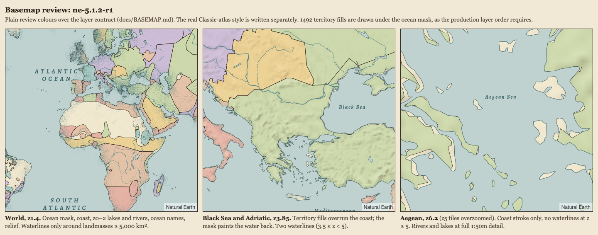

# Physical basemap (Natural Earth)

The remastered historical map draws its physical geography from a first-party basemap: static vector tiles, a shaded-relief image and a small land file for the locator globe. All of it is built once from Natural Earth and served from our own origin. There is no tile server, no token and no third-party request. See `docs/product/REMASTER_PLAN.md` §2.1 and §5 for why, and the "First-party Natural Earth basemap" decision in `docs/product/DECISIONS.md`.

The basemap shows no modern borders, roads or place names. Its only names are seas and oceans.



_The basemap layers with plain review colours, made by `yarn basemap:review`. The 1492 territory fills are drawn under the ocean mask, so the Black Sea and Adriatic coastlines stay true. This is not the Classic-atlas style, which the style module draws._

## Sources, license and attribution

| Input                                   | Pinned source                                                          | Used for                               |
| --------------------------------------- | ---------------------------------------------------------------------- | -------------------------------------- |
| `ne_50m_land`                           | `nvkelso/natural-earth-vector` tag `v5.1.2`, `geojson/`                | Ocean mask, coastlines, landmass areas |
| `ne_50m_lakes`                          | same                                                                   | Lakes                                  |
| `ne_50m_rivers_lake_centerlines`        | same                                                                   | Rivers (class `River` only)            |
| `ne_50m_geography_marine_polys`         | same                                                                   | Sea and ocean label points             |
| `ne_110m_land`                          | same                                                                   | Locator-globe land                     |
| `GRAY_50M_SR` (Gray Earth relief 2.0.0) | `naciscdn.org/naturalearth/50m/raster/GRAY_50M_SR.zip`, pinned by hash | Shaded relief                          |

Every file is pinned by URL, sha256 and byte size in `data/basemap-sources.json`. The relief URL has no version in it, so its hash is the pin.

- **License.** Natural Earth is in the public domain ([terms of use](https://www.naturalearthdata.com/about/terms-of-use/)). Credit is optional, but we keep it.
- **Attribution text.** The map's attribution control shows `<a href="https://www.naturalearthdata.com/">Natural Earth</a>`, which is the `attribution` field of the manifest and of `tiles.json`. About should say: "Physical geography: Natural Earth (public domain)." Both sit alongside the historical-basemaps (GPL-3.0) credit and the font licenses.
- **Design overrides.** `labelOverrides` in `data/basemap-sources.json` holds deliberate changes to source data. Today there is one: "North Atlantic Ocean" becomes "Atlantic Ocean" at 19° W, 46° N, so the name sits in the European view, as in the design spike.

## What is published

The build ID is `ne-5.1.2-r1`, meaning Natural Earth 5.1.2, recipe revision 1. Each build gets its own directory, so every file can be cached as immutable.

| Path (under `public/`)                      | URL                                          | Content                                       |
| ------------------------------------------- | -------------------------------------------- | --------------------------------------------- |
| `tiles/basemap/ne-5.1.2-r1/{z}/{x}/{y}.pbf` | `/tiles/basemap/ne-5.1.2-r1/{z}/{x}/{y}.pbf` | Vector tiles, z0–5, every tile present        |
| `basemap/ne-5.1.2-r1/relief.webp`           | `/basemap/ne-5.1.2-r1/relief.webp`           | Tinted shaded relief, 2048×1091, Web Mercator |
| `basemap/ne-5.1.2-r1/land-110m.geojson`     | `/basemap/ne-5.1.2-r1/land-110m.geojson`     | Locator-globe land, 1:110m                    |
| `basemap/ne-5.1.2-r1/tiles.json`            | `/basemap/ne-5.1.2-r1/tiles.json`            | TileJSON 3.0.0 describing the tiles           |

`data/basemap-manifest.json` is the machine-readable record of a build. It holds the source hashes, URLs, per-zoom counts and bytes, a digest of the whole tile tree, the relief coordinates and the asset hashes. The style module should read its URLs and the relief coordinates from it at build time rather than copying them.

**Headers** (`public/_headers`). Wrangler 4.164 sends `.pbf` with no `Content-Type`, and sends `.mvt` as `application/vnd.mapbox-vector-tile`, which Cloudflare does not compress. The rules therefore set:

- `/tiles/*` → `Cache-Control: public, max-age=31536000, immutable`;
- `/tiles/*.pbf` and `/tiles/*.mvt` → `Content-Type: application/x-protobuf`, which is on Cloudflare's compression list;
- `/basemap/*` → the same immutable `Cache-Control`;
- `/basemap/*.webp` → `Content-Type: image/webp`.

Wrangler already sends `.geojson` as `application/geo+json` and `.json` as `application/json`.

- **Observed** in the asset worker bundled with Wrangler 4.164: the first `_headers` rule that sets a header replaces the default, and a later matching rule appends to it (`a, b`). A test (`tests/basemap-data.test.ts`) resolves `public/_headers` the same way, and checks that every basemap path gets exactly one `Content-Type` and one `Cache-Control`.
- **Unverified:** whether Workers Static Assets compresses `application/x-protobuf` responses like the CDN does. That is plan P0 check (2).

Glyph PBFs under `/glyphs/` are not covered by these rules. The fonts track owns them.

## Layer contract

One vector source holds five `source-layer`s. The tiles are Mapbox Vector Tile v2 with extent 4096 and a 64-unit buffer, and are meant for MapLibre's default 512 px vector tile size.

```ts
basemap: {
  type: 'vector',
  tiles: [`${origin}/tiles/basemap/ne-5.1.2-r1/{z}/{x}/{y}.pbf`], // absolute URL
  minzoom: 0,
  maxzoom: 5, // MapLibre overzooms z5 to the app's z10
  attribution: '<a href="https://www.naturalearthdata.com/">Natural Earth</a>',
}
```

| `source-layer`  | Geometry   | Attributes (type)                                                 | In tiles                     |
| --------------- | ---------- | ----------------------------------------------------------------- | ---------------------------- |
| `ocean`         | Polygon    | none                                                              | all zooms                    |
| `coast`         | LineString | `landmass_km2` (number, always present)                           | all zooms                    |
| `lakes`         | Polygon    | `rank` (number, always), `name` (string, optional)                | thinned below z3 (see below) |
| `rivers`        | LineString | `rank` (number, always), `name` (string, optional)                | thinned below z3 (see below) |
| `marine_labels` | Point      | `name` (string), `kind` (string), `rank` (number), all always set | all zooms                    |

The validator fails a build that has any other layer or attribute, or the wrong geometry or type. Details per layer:

- **`ocean`: the ocean mask.** The world minus Natural Earth 1:50m land. The Caspian Sea is a hole in the land, so it is part of the mask. Paint it **above** the territory fills, so water covers wherever a historical polygon overruns a coast. The fill polygons are cut on the z3 tile grid: 45° of longitude by one z3 Mercator row, 64 cells, so no polygon carries hundreds of island holes.
  - **Why not 30° cells, as the plan suggested:** with tile-aligned cells, every cell edge at z3 and above is also a tile edge, and MapLibre's per-tile stencil clipping hides it.
  - **Observed:** no seam is visible over overrunning fills at z2.4–2.7 either, as checked on the 41° N cell edge across the Black Sea's south coast and the 0° edge in the Gulf of Guinea.
  - Use no `fill-outline-color` other than the fill colour.
- **`coast`: coastlines.** These are the rings of the land polygons, minus the artificial edges that Natural Earth adds along the antimeridian and the south pole.
  - **Orientation.** Rings are wound per RFC 7946, so **water is always on the right-hand side of the line**. A positive `line-offset` moves a stroke seaward. The waterlines use this, as in the design spike (`[2.5, 5.5, 9.5, 14.5]`). It also holds for the Caspian shore, which is an inner ring.
  - **`landmass_km2`.** The geodesic area of the land polygon the ring bounds, in km², rounded. Holes are subtracted, and the value is ≥ 1. For Afro-Eurasia it is 79,544,473. Small islands have small values. A landmass split at the antimeridian counts as two pieces.
  - **Waterline rule (plan §2.1).** Four waterlines below z3.5, two from z3.5 to z5, none from z5; filter `['>=', ['get', 'landmass_km2'], 5000]`. 118 of 1,422 coast features qualify.
- **`lakes`.** All 412 Natural Earth 1:50m lakes and reservoirs, with `rank` = Natural Earth `scalerank` (0–6) and `name` when Natural Earth has one. Lakes are not duplicated in `ocean`. Paint them above the territory fills too; the plan's order puts them after the coast.
- **`rivers`.** All 359 Natural Earth 1:50m features of class `River`; lake centerlines are excluded. `rank` = `scalerank` (1–6, with 1 the largest), and `name` = `name_en`, falling back to `name`. The design spike draws `rank ≤ 6`, with wider strokes for ranks 1–2, and labels ranks ≤ 2 from z3.2.
- **Lake and river thinning.** A lake or river first appears at tile zoom `max(0, ceil(NE min_zoom) − 2)`. Natural Earth's `min_zoom` assumes 256 px tiles, and MapLibre draws 512 px tile _z_ from map zoom _z_. So every feature is in the tiles at least one map zoom before Natural Earth suggests showing it, and the style keeps full control with filters or `minzoom`.
  - Tile z0 carries 44 lakes and 22 rivers. Everything is present from tile z3, which is used from map zoom 3.
  - This trimmed the z0 tile from 98 KB to 74 KB.
- **`marine_labels`.** One point per Natural Earth marine polygon with `scalerank ≤ 4`: 118 names. The point is placed at the pole of inaccessibility of the feature's largest polygon (`polylabel`, 0.5° precision).
  - `name` is title-cased ("SOUTHERN OCEAN" becomes "Southern Ocean"), apart from the overrides above.
  - `kind` is Natural Earth's `featurecla` in lowercase: `ocean`, `sea`, `bay`, `gulf`, `strait`, `channel`, `sound`, `reef` or `river`. Upper-case `kind == 'ocean'` with wide spacing, as in the design spike.
  - `rank` = `scalerank`, 0–4. The mock shows `rank ≤ 3`.

Points are written once, into the tile that contains them, plus that tile's buffer.

**Tiles with nothing in them.** Tiles entirely inland have no water. Each still exists, as a tiny valid tile holding an empty `ocean` layer: 155 of the 1,365. The pyramid is therefore complete and the map never requests a missing tile. Decoders skip empty layers, so these tiles read as empty.

**Relief.** Add it as an image source, using the manifest's `relief.coordinates`:

```ts
relief: {
  type: 'image',
  url: `${origin}/basemap/ne-5.1.2-r1/relief.webp`,
  coordinates: [[-180, 76], [180, 76], [180, -58], [-180, -58]],
}
```

- **Method.** The image is the local relief of `GRAY_50M_SR`: the pixel minus a 14 px blur, reprojected to Web Mercator between 76° N and 58° S. It is tinted with Direction A's sepia shadow `rgb(96,72,44)`, up to 50% alpha, and cream light `rgb(255,250,236)`, up to 42% alpha, and saved as a lossy WebP with alpha.
- **Painting.** Paint it above the fills and below the borders (`raster-opacity` about 0.9 in the mock), and add it after the first map paint (plan §5).
- **Resolution.** At 2048 px wide it is sharp to about z2, and softens visibly by z4: compare the middle panel of the review image. This is the design spike's choice and fits the plan's ~550 kB target. If the owner wants crisper relief at z4–6, the follow-up is z0–5 WebP raster tiles. Those are neither measured nor budgeted yet.

**Locator globe** (`land-110m.geojson`). A GeoJSON FeatureCollection of 127 `Polygon` features. Each holds only the outer ring of a Natural Earth 1:110m land polygon, counter-clockwise, rounded to 0.1°, with no properties. The file is 75 KB raw.

- **Why a file, not a tile layer.** The globe is drawn on a canvas in orthographic projection. It needs whole-world rings, not tile-clipped pieces, and should not need a tile decoder.
- **Loading.** Load it with the map key (plan §2.1), not on first paint.

**Layer order.** This is the plan's order (§2.1) mapped to this contract. Graticule, edge bands, borders and labels come from other sources:

`background` (land colour) → territory fills → `relief` → edge bands → borders and selection → `ocean` → graticule → waterlines (`coast`, offset) and the `coast` stroke → `lakes` (fill and shore) → `rivers` → labels, including `marine_labels`.

A land fill layer isn't needed: the land colour is the `background`, and the mask paints the sea.

## Max zoom: z5 (measured)

`yarn data:measure:basemap` builds every candidate max zoom in memory. geojson-vt keeps every source vertex at its index's `maxZoom`, so **each candidate carries the full 1:50m detail at its top zoom**. What changes is the file count, the bytes, and how coarse the coordinate grid becomes when MapLibre overzooms to the app's z10. Measured 2026-11-17, complete pyramids, extent 4096:

| Max zoom | Files  | Of which placeholders | Bytes   | Top-zoom bytes | Largest tile | Grid step at equator | Worst snap at z10 |
| -------- | ------ | --------------------- | ------- | -------------- | ------------ | -------------------- | ----------------- |
| 3        | 85     | 0                     | 0.80 MB | 443 KB         | 74 KB        | 1,223 m              | 8 px              |
| 4        | 341    | 21                    | 1.12 MB | 484 KB         | 74 KB        | 612 m                | 4 px              |
| **5**    | 1,365  | 155                   | 1.61 MB | 590 KB         | 74 KB        | 306 m                | 2 px              |
| 6        | 5,461  | 885                   | 2.43 MB | 850 KB         | 74 KB        | 153 m                | 1 px              |
| 7        | 21,845 | 4,673                 | 3.90 MB | 1.49 MB        | 74 KB        | 76 m                 | 0.5 px            |

**Decision: z5.**

- **Detail.** The source vertices are 3.0 km apart at the 10th percentile and 7.6 km at the median. A 306 m grid step loses nothing visible, and at z10 a 2 px snap is small next to the 1:50m generalization itself.
- **Files.** z6 quadruples the files and would take 5,461 of the 16,000-file gate the plan sets so that the PA street tree (~10k files) still fits. z7 alone exceeds Cloudflare's 20,000-file limit.
- **Why not z4.** z4 would save about 1,000 files. But each overzoomed tile at high zoom re-parses a parent covering four times the area, and the snap doubles to 4 px.

## Budgets

These are enforced by `yarn data:validate:basemap`, with limits in `BUDGETS` in `scripts/lib/basemap.js`:

| Budget                                        | Limit                                      | Current                   |
| --------------------------------------------- | ------------------------------------------ | ------------------------- |
| Basemap files (tiles + 3 assets)              | 1,500                                      | 1,368                     |
| Tile bytes, total                             | 3 MiB                                      | 1,614,286 B               |
| Largest tile                                  | 80 KiB                                     | 73,781 B (z0)             |
| `relief.webp`                                 | 900 KiB                                    | 578,004 B                 |
| `land-110m.geojson`                           | 160 KiB                                    | 74,742 B                  |
| Any single file                               | 25 MiB (Workers Static Assets)             | well under                |
| Whole deployment (context, not enforced here) | 16,000 repository gate / 20,000 Cloudflare | today's `out/` plus 1,368 |

Per zoom, observed in `data/basemap-manifest.json`:

| z   | Tiles | Bytes   | Largest |
| --- | ----- | ------- | ------- |
| 0   | 1     | 73,781  | 73,781  |
| 1   | 4     | 114,772 | 40,761  |
| 2   | 16    | 172,112 | 25,090  |
| 3   | 64    | 273,468 | 21,193  |
| 4   | 256   | 390,214 | 9,566   |
| 5   | 1,024 | 589,939 | 5,758   |

The app's `minZoom` is 1, so it never requests the z0 tile. A typical world view at map zoom 1.5–2 loads four to eight z1/z2 tiles, about 100–170 KB raw before compression. A Europe view at z4 loads about a dozen z4 tiles, about 20–60 KB.

**File budget.** The whole-deployment file count, including PA and rollback assets, belongs to the test-harness track and `yarn static:validate` (`MAX_CLOUDFLARE_FILES`). The basemap's share is capped here.

## Regenerating

The refresh is explicit and network-using. It never runs in `yarn build`, CI or deploy.

```bash
source ~/.nvm/nvm.sh && nvm use 22
yarn install --frozen-lockfile
yarn data:refresh:basemap     # download (cached), verify hashes, rebuild everything (~1 min)
yarn data:validate:basemap    # offline checks; also part of `yarn data:validate`
yarn test tests/basemap-data.test.ts
```

- **Cache.** Downloads are cached in `.cache/basemap/`, which is gitignored, or in `BASEMAP_CACHE_DIR`. Any cached or downloaded file whose sha256 or size differs from `data/basemap-sources.json` stops the refresh.
- **Upgrading a source.** Edit the URL in `data/basemap-sources.json`, run `yarn data:refresh:basemap --pin` to record the new hashes, review the diff, and bump the build ID.
- **Changing the recipe** (anything that changes published bytes): bump `BUILD_ID` in `scripts/lib/basemap.js` (`-r2`, …). The refresh deletes the old build directories, and the validator rejects stale ones.
  - Production rollback relies on Worker versions, which keep their own asset sets.
  - Update the style's URLs from the manifest.
- **Measuring.** `yarn data:measure:basemap` reprints the max-zoom table. It writes nothing.
- **Reproducibility.** The refresh is deterministic on one machine. **Observed:** a second run produced an identical manifest, including the tree digest and the relief hash. The relief WebP depends on the libvips version bundled with `sharp` 0.35.5, so another platform may encode slightly different bytes. If so, commit the regenerated files and manifest together.

Libraries: `geojson-vt` and `vt-pbf` (tiling), `martinez-polygon-clipping` (ocean mask), `polylabel` (sea labels), `@turf/area` (landmass areas), `sharp` (relief), and `@mapbox/vector-tile` with `pbf` (validation). They are pinned as devDependencies, at the versions already in `yarn.lock`.

## Validation

`yarn data:validate:basemap` is offline and runs in about 2 s. It checks:

1. **Sources.** Every source is HTTPS and pinned to the Natural Earth release tag, with a sha256 and a byte size, and the license is public domain. The manifest was built from exactly those hashes.
2. **Build.** Only the current build's directories exist under `public/tiles/basemap/` and `public/basemap/`.
3. **Tile tree.**
   - Only `{z}/{x}/{y}.pbf` files are present.
   - The pyramid z0–maxzoom is complete. A missing tile would let territory fill show in the sea.
   - Per-zoom counts and bytes match the manifest, and the tree digest matches, so tiles cannot change without a refresh.
   - The per-tile, total and 25 MiB limits hold.
4. **Layer contract, in every decoded tile.** There are no unknown layers or undocumented attributes; geometry types and attribute types are correct; `landmass_km2` is > 0; every layer exists, and all five appear in the z0 tile.
5. **Assets.**
   - The relief is a WebP with alpha, with the manifest's dimensions, hash and coordinates, and within its budget.
   - The globe is a non-empty FeatureCollection of Polygons, with a matching hash, within its budget.
   - `tiles.json` points at this build and lists exactly the contract layers.
6. **File share.** The basemap ships ≤ 1,500 files.

`tests/basemap-data.test.ts` covers each rule with failing fixtures, the geometry helpers, tile encoding and thinning, the placeholder tile, the zip and WebP readers, the committed basemap, and the `_headers` resolution.

## Visual review

`yarn basemap:review` renders the layers with plain colours, with the 1492 territory fills underneath, and rewrites `docs/product/basemap-review.png`. It needs MapLibre GL JS 6.19.0 (the plan's pin) in the gitignored cache, once:

```bash
mkdir -p .cache/basemap-review && cd .cache/basemap-review
printf '{"private":true,"dependencies":{"maplibre-gl":"6.19.0"}}\n' > package.json
yarn install --ignore-scripts --no-lockfile && cd ../..
PLAYWRIGHT_BROWSERS_PATH="/Volumes/External SSD/Developer/Caches/ms-playwright" yarn basemap:review
```

- **Ad-hoc cameras.** `BASEMAP_REVIEW_VIEW=lon,lat,zoom BASEMAP_REVIEW_OUT=/path.png` renders one camera in all three panels.
- **Glyphs.** Labels use the design spike's Alegreya glyph bundle until the glyph build lands.
- **Not production code.** The review page (`scripts/basemap-review/index.html`) is a review aid only, not the production style.

## Open items

- **P0.** Confirm that `application/x-protobuf` tiles are compressed by Workers Static Assets, and that `_headers` content types apply on the real host.
- **Relief sharpness at z4 and above.** This waits on the owner's screenshot review. The option is WebP raster tiles (not measured).
- **Sea names are modern English names** from Natural Earth. They suit a physical basemap, but they are not period names. Any change is a style or data decision for the cartography track.
