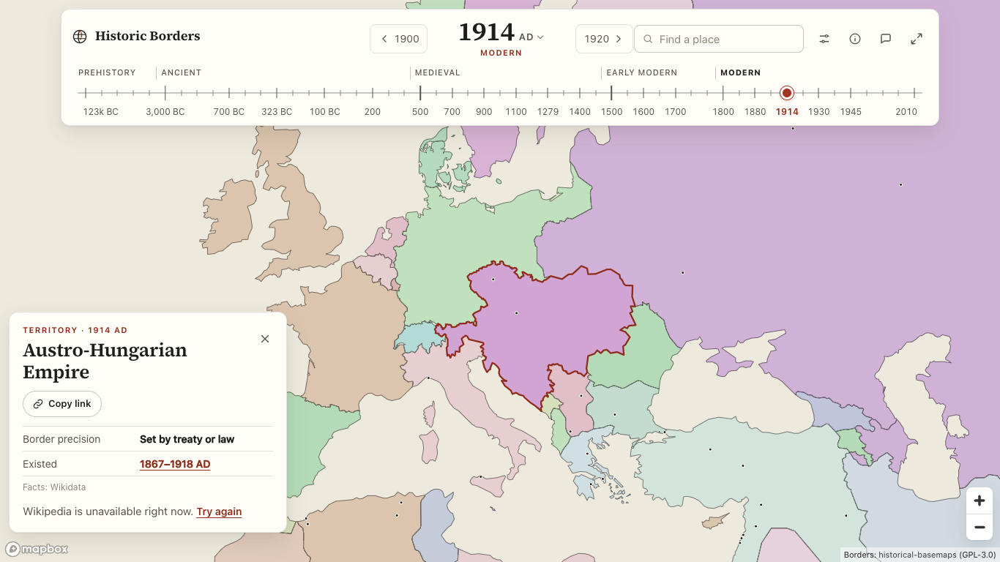
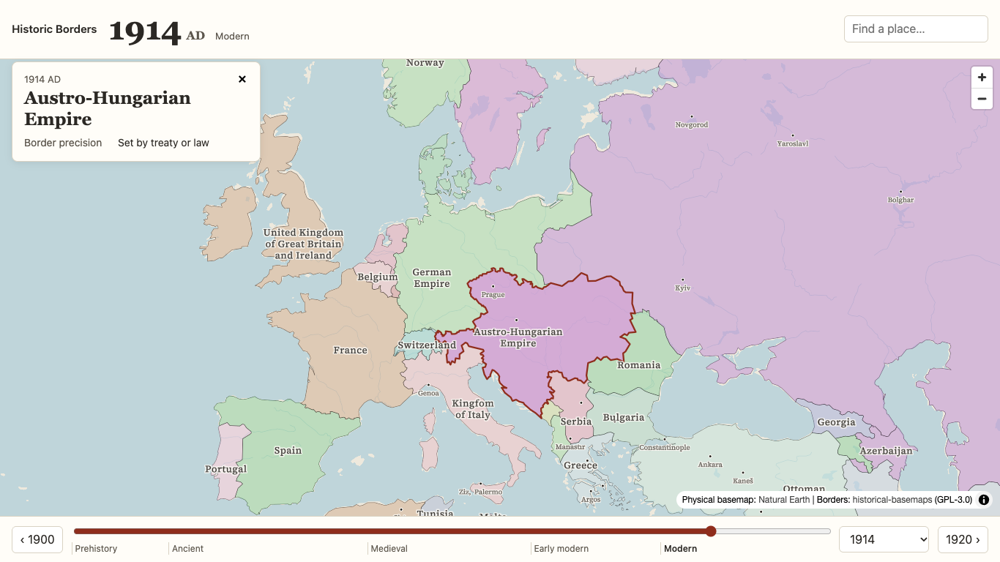
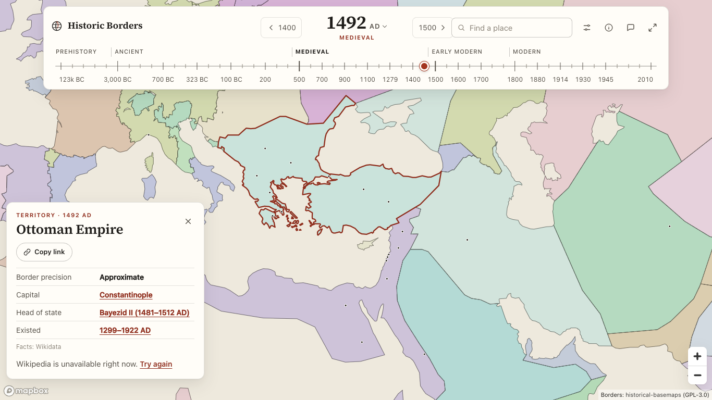
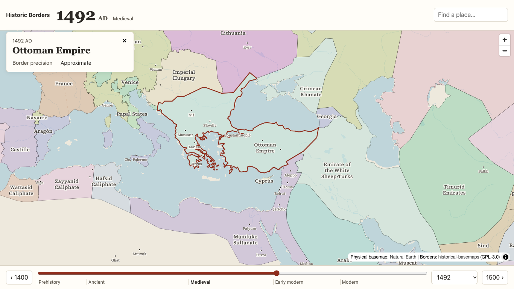

# Remaster plan: renderer, basemap, data, framework, and migration

Status: proposal for owner review. Written 2026-11-17 by the architecture agent on branch `t3/historic-borders-remaster`.

Inputs: `AGENTS.md`, `PRODUCT.md`, `docs/product/REVAMP_AUDIT.md`, `docs/product/DECISIONS.md`, `docs/CLOUDFLARE_DEPLOYMENT.md`, `docs/HISTORICAL_DATA.md`, `docs/HISTORICAL_CONTEXT.md`, the workspace data-source study (`ideas/historic-borders-data-sources.md`), and the classroom UI review (`ideas/historic-borders-ui-review.md`).

Evidence: a working spike in `remaster-spike/`, measured against the current app. The spike's README explains how to rerun everything.

**Target visual design (owner decision, 2026-11-17, final):** Direction A, "Classic atlas", from the design spike on branch `t3/living-atlas-design` (commit `48aaf45`, spec `design/living-atlas/README.md`), with three pieces taken from Direction B. See §2.1.

Conventions: **Observed** marks facts checked on the date given. **Assumption** marks things not verified. **Recommendation** marks this memo's proposals.

## 1. Recommendation in one paragraph

Rebuild the historical atlas as a static **Astro 7** site. Every year page, the PA page, the 404 page, the sitemap, and the OG metadata are prerendered HTML. The interactive atlas is one **React 19** island. Draw the map with **MapLibre GL JS 6** (BSD-3) through a small imperative controller, not a React map wrapper, and drop Mapbox entirely.

The historical map uses a **first-party physical basemap** built once from Natural Earth (public domain) as a static z/x/y vector-tile tree. That tree includes the precomputed **ocean mask that is painted over the territory fills**, so coastlines stay true wherever the historical polygons overrun them.

Map labels use **self-hosted OFL fonts**: Alegreya and Alegreya SC by default, and Atkinson Hyperlegible Next for the optional projector text setting. They are served as build-time glyph PBFs from our own origin, so the historical map makes no third-party requests at all.

Keep **per-year GeoJSON** as the historical data format, slimmed and split into three files:

- border polygons;
- labels and places;
- a small territory index.

MapLibre's worker fetches and parses the polygons by URL, so the main thread never holds a parsed copy. The data stays in Workers Static Assets with the existing validation pipeline. Vector tiles are deferred behind a measured trigger.

The PA school-district map moves to a **self-hosted Protomaps (OpenStreetMap) extract** for streets and names. It also needs a measured fix for its 1.8 MB district file.

Port the current UI components, their behavior and their tests rather than rewriting them. Restyle them to **Direction A, "Classic atlas"**, adding three pieces from Direction B: the corner map key with a locator globe, legend and scale bar; the "Key dates" lifespan bar; and Atkinson Hyperlegible as an optional large-text setting (§2.1).

## 2. Scope boundaries set by the owner

### 2.1 Target visual design: Direction A, "Classic atlas" (owner decision, final)

**The spike's UI is not the design.** The spike's interface is a **throwaway measurement harness**: a bottom slider, a `<select>`, and a plain header. It exists only to exercise the renderer, data path, URL state and selection under throttling, and its screenshots should not be read as a design. The remaster **does not adopt the spike's bottom slider or `<select>`**.

**What is built.** The target is **Direction A, "Classic atlas"**, specified in `design/living-atlas/README.md` with HTML/MapLibre mockups (`a-classic-atlas.html`, `shots/a-classic-atlas-*.png`). The source is branch `t3/living-atlas-design`, commit `48aaf45`. The remaster:

- **keeps the current top timeline and existing components and restyles them as A.** Behavior, ARIA and tests are ported from `components/*` (§9.3); only markup details and CSS change. A's timeline maps one-to-one onto today's:
  - the compass-rose brand with Alegreya SC;
  - a plate-title year ("1492 AD") with the era in accent small caps;
  - previous and next buttons;
  - watercolour era washes framed in ink above an alternating ladder track;
  - a madder-diamond thumb;
  - the selected year always printed on the ruler.
- **takes A's tokens:** paper `#F1E9D6`, sheet `#FBF6EA`, ink `#2A2017`, ink-2 `#554536`, water `#BFD2D0`, the five era pigments and washes (the era of the year sets the UI accent; Medieval is madder `#8B2A2A`), and the 12 hand-tinted map washes with darker edges. The design spike's contrast checks (`tools/contrast.cjs`) become a unit test against the token file.
- **takes A's cartography,** in the MapLibre style module:
  - Alegreya SC state names sized by `log10(area)`, the selected territory always labelled, and halos;
  - italic water names;
  - each city marker as the icon of its own symbol, so a dot never appears without its name;
  - the edge-band "Grenzkolorit" inside borders;
  - a madder band and line for the selection;
  - relief above the fills;
  - a 10° graticule and the degree-ladder neatline (a single rule on phones);
  - the cartouche ("The World in 1492", scale bar, north arrow);
  - the gazetteer-page panel: fact box, drop cap, credit strip.
- **adds three pieces from Direction B:**
  1. **Corner map key.** A small orthographic locator globe (Natural Earth 1:110m land, on canvas, with the current view outlined in the era accent), a legend, and an alternating scale bar with north arrow. It is restyled as a cartouche in A's frame language and **merged with A's cartouche** into one bottom-left key: title, globe, legend, scale bar, north.
     - The legend is real HTML text, and lists only symbol classes the map actually draws: selected territory, capital, city, and archaeological site (∴, once the data has a site class).
     - On phones the key collapses to the scale bar plus a "Key" toggle. It stays clear of the bottom sheet and of the safe-area insets.
     - The globe redraws on `moveend`, never per frame.
  2. **"Key dates" lifespan bar in the place panel.** A bar from the territory's start to its end, with the map year marked "This map".
     - Data comes from the static Wikidata facts already published per year (`existed.start` / `existed.end` in `public/data/context/*.json`; see `docs/HISTORICAL_CONTEXT.md`). Approximate bounds are drawn as soft ends and labelled "c.".
     - The bar is **hidden when lifespan is unknown.** Observed: about 19% of name-years have any Wikidata fact. Nothing is invented.
     - B's event table under the bar is **out of scope** until a curated, sourced key-dates list exists. The design spike says the same of its sample content.
  3. **Atkinson Hyperlegible Next as an optional large-text setting** for projectors and low vision. Alegreya stays the default.
     - The Settings panel gets a "Projector text" option. It swaps the UI font token and the map `text-font` stacks to Atkinson (Medium/Bold) and raises label sizes.
     - Because MapLibre cannot synthesize small caps, Atkinson state names use uppercase plus letter-spacing.
     - Its WOFF2 and glyph PBFs load only when the setting is on. It persists with the other settings, and focus/projector mode suggests it.
- **tones down A's engraved coastline waterlines at higher zoom.** On the phone mock they read as busy moiré around the Aegean islands. The style rule:
  - four waterlines only at z < 3.5;
  - two at 3.5 ≤ z < 5;
  - none at z ≥ 5, where the coast stroke alone remains;
  - opacity ramps down with zoom;
  - waterlines are drawn only around coastlines of landmasses ≥ 5,000 km². The basemap build tags coastline features with their landmass area, so small islands get the coast stroke but no ripples.
- **makes the "ocean painted over borders" coastline fix part of the basemap contract.** The historical polygons overrun coastlines; parts of the Black Sea and the Adriatic lie inside territory polygons.
  - The basemap build precomputes an **ocean mask**: the world minus Natural Earth land, clipped into 30° cells so no polygon carries hundreds of holes. Lakes are added to it.
  - The layer order is the design spike's: land → territory fills → relief → edge bands → borders and selection → **ocean mask** → graticule → coast and waterlines → lakes → rivers → labels.
  - The spike in this repository still draws land under the borders, so its screenshots show the overrun. Fixing it is an P1 item.
- **uses self-hosted OFL fonts only** (§5): Alegreya, Alegreya SC and Alegreya Sans (Huerta Tipográfica), and Atkinson Hyperlegible Next (Braille Institute), from `@fontsource` builds, with the license copies shipped. The same fonts become map glyph PBFs.

The mockups load MapLibre **5.24** from unpkg and embed their data as base64 so they open from disk. Production uses MapLibre 6, self-hosts everything, and keeps those techniques out. The design spike's own production notes (§"Production notes for MapLibre") are adopted as-is.

### 2.2 iPhone safe areas are a hard requirement

Every remaster page must handle:

- the notch or Dynamic Island, in both orientations;
- Safari's top and bottom toolbars, which collapse and expand;
- the home indicator.

Rules:

1. The viewport meta tag includes `viewport-fit=cover`. Edge-anchored UI pads with `env(safe-area-inset-top|right|bottom|left)`, usually as `max(var(--gutter), env(safe-area-inset-*))`.
2. Full-height layouts use `dvh` (or `svh` when a stable minimum is needed). **`100vh` is banned.** A stylelint rule (`unit-disallowed-list` for `vh` on `height`/`min-height`, or a simple grep in `yarn lint`) enforces it. That includes the `100vh` fallback in the design mock's shell: use `height: 100%` on `html, body` as the old-browser fallback before `100dvh`.
3. **No fixed bottom bars** that can sit under the home indicator or Safari's bottom toolbar. Bottom sheets, such as the phone place panel, keep `bottom: max(var(--gutter), env(safe-area-inset-bottom))` and a `dvh` max-height. Primary controls stay at the top, consistent with the kept top timeline.
4. Landscape needs `safe-area-inset-left/right`. The current CSS handles top and bottom only (observed: no `safe-area-inset-left/right` in `styles/index.css`), so this is a known gap to close in P1.

The acceptance check is in §9.4 and is required by every milestone from P1 on.

**Observed with `remaster-spike/scripts/check-safe-areas.mjs`** (Chromium emulating iPhone devices, with simulated insets):

- **Current app (`bd23544`)** fails 15 of 27 cases:
  - On iPhone 15 Pro portrait, the map attribution button sits in the bottom 34 px home-indicator zone of both year pages.
  - In iPhone 15 Pro landscape, the zoom buttons and attribution sit under the right-hand notch inset, and the 404 page's title and buttons start under the left inset.
  - iPhone SE passes everywhere.
- **Spike** passes 27 of 27, using the §2.2 rules.
- Real Safari can differ from this emulation; that is why the manual iPhone check stays.

### 2.3 Tablet widths and forced dark mode are hard requirements

The owner hit two defects that are now fixed on the current app. The remaster must not reintroduce them.

- **Tablet top bar.** On an iPad in Safari, about 1000 CSS px wide, the top bar ran off the right edge. The fix is commit `3ebf542` ("keep the top bar inside tablet widths without overlaps", branch `t3/topbar-fit`; the owner reports it merged to main). Below 1280 px the place finder collapses to a search button, and the two-row header applies up to 860 px. The ported `Timeline`/`Toolbar`/`PlaceFinder` must carry those breakpoints. Direction A's taller timeline must be checked at every tablet width, because the mockups were shot only at 1440 and 390/393 px.
- **Forced dark mode.** Commit `902d770` sets `color-scheme: only light` on `:root` and `<meta name="color-scheme" content="only light">`, so browsers that auto-darken pages leave the light-only atlas palette alone. Chrome's "Auto Dark Mode for Web Contents" and Samsung Internet are examples. The Astro layout and the global tokens file must keep both. The spike already does.

The acceptance checks are §9.5 and §9.6, required from P1 on.

The measured "current app" in §8 is `bd23544`, which predates both fixes. They are CSS and meta changes only and do not affect the performance comparison.

## 3. Dated facts

Checked 2026-11-17 against the npm registry and official documentation or release notes.

### 3.1 Releases

| Package                        | Current        | Notes                                                                                                                                                                                            |
| ------------------------------ | -------------- | ------------------------------------------------------------------------------------------------------------------------------------------------------------------------------------------------ |
| `maplibre-gl`                  | 6.19.0         | v6.0.0 shipped 2026-07-22. ESM-only, **WebGL2 required** (WebGL1 dropped), ES2022, `Map` no longer extends `Camera`. v5.x (globe since 5.0) is still patched (5.24.1, 2026-11-11). BSD-3-Clause. |
| `deck.gl`                      | 9.4.1          | MIT. Draws no styled basemap; runs with MapLibre/Mapbox/Google. WebGPU and `_GlobeView` experimental. 9.4 is expected to be the last v9 release.                                                 |
| `ol` (OpenLayers)              | 10.11.0        | BSD-2. WebGL vector layer since 10.3; WebGL text since 10.10. Canvas vector tiles remain the mature labeled path. No 3D globe.                                                                   |
| `mapbox-gl`                    | 3.35.0         | Proprietary; usable only with Mapbox services. 50k map loads/month free, then $5 per 1,000.                                                                                                      |
| `pmtiles`                      | 4.5.0          | Protomaps builds now listed at `maps.protomaps.com/builds`; `build.protomaps.com` returns 404.                                                                                                   |
| `astro`                        | 7.4.12         | Astro 7 (2026-06-22): Rust compiler, Vite 8. **Requires Node ≥ 22.23.4** (engines field). Cloudflare announced the Astro team joining it on 2026-01-16; Astro stays MIT.                         |
| `react` / `react-dom`          | 19.3.1         | React Compiler 1.0 stable since 2025-10-07.                                                                                                                                                      |
| `preact`                       | 11.2.0         |                                                                                                                                                                                                  |
| `next`                         | 16.4.6         | Turbopack default. `output: 'export'` excludes rewrites, redirects, headers, ISR, Server Actions, and default image optimization.                                                                |
| `vite`                         | 8.3.8          | Rolldown is the only bundler.                                                                                                                                                                    |
| `solid-js` / `svelte`          | 2.0.0 / 5.57.3 |                                                                                                                                                                                                  |
| `vitest`                       | 5.1.0          | Browser Mode stable since Vitest 4 (Playwright provider `@vitest/browser-playwright`). Needs Node ≥ 22.12.                                                                                       |
| `@playwright/test`             | 1.65.1         |                                                                                                                                                                                                  |
| `react-aria-components`        | 1.22.1         |                                                                                                                                                                                                  |
| `tailwindcss`                  | 4.3.5          |                                                                                                                                                                                                  |
| `nuqs`                         | 2.10.3         |                                                                                                                                                                                                  |
| `@tanstack/react-router`       | 1.170.46       |                                                                                                                                                                                                  |
| `flatgeobuf` / `geobuf`        | 4.6.1 / 4.0.0  |                                                                                                                                                                                                  |
| `wrangler`                     | 4.164.0        | Same as the repository.                                                                                                                                                                          |
| tippecanoe (`felt/tippecanoe`) | 2.82.0         | Maintained; writes PMTiles directly. No official WASM/npm build: Homebrew, source, or Docker.                                                                                                    |

### 3.2 Platform facts

**Workers Static Assets.** Sources: [billing and limitations](https://developers.cloudflare.com/workers/static-assets/billing-and-limitations/) (page updated 2026-11-12) and [limits](https://developers.cloudflare.com/workers/platform/limits/).

- Requests to static assets are free and unlimited. The exception is the new _Workers Caching_ option, which bills cached static requests; leave it off.
- Free plan: 20,000 files per Worker version and 25 MiB per file.
- Range requests are **not** honored. A request with a Range header gets `200` and the whole file.

**Content types and compression.** Sources: [compression](https://developers.cloudflare.com/speed/optimization/content/compression/) and [static asset headers](https://developers.cloudflare.com/workers/static-assets/headers/).

- Wrangler 4.164 assigns `application/geo+json` to `.geojson` and `application/vnd.mapbox-vector-tile` to `.mvt`.
- It assigns **no** type to `.pbf` or `.pmtiles`. Observed in the published `wrangler-dist/cli.js`, where they get `application/null` and are sent without a `Content-Type`.
- Cloudflare's default compression list includes `application/x-protobuf`, `application/geo+json`, and `application/json`. It does not include `application/vnd.mapbox-vector-tile`.
- Whether static-asset responses are compressed exactly like CDN responses is **unverified**. The P0 acceptance check verifies it on a preview deployment.

**R2.** Sources: [pricing](https://developers.cloudflare.com/r2/pricing/), [public buckets](https://developers.cloudflare.com/r2/buckets/public-buckets/), and [range requests](https://developers.cloudflare.com/cache/reference/range-requests/).

- Free tier: 10 GB-month of storage, 1M Class A and 10M Class B operations per month, and free egress.
- Through a custom domain, Cloudflare's cache serves single-range `206` responses. A `.pmtiles` file needs a Cache Rule, and the largest cacheable file on Free is 512 MB.
- `r2.dev` URLs are rate-limited and intended for development only.

**Free tile hosts.**

- [OpenFreeMap](https://openfreemap.org/tos/): free, no key, no stated limits. It offers no SLA, may stop "at any time without notice", and serves from `tiles.openfreemap.org`.
- [VersaTiles](https://docs.versatiles.org/guides/use_tiles_versatiles_org.html): a demo server with per-IP 429s. It advises self-hosting.

**Protomaps basemap.** Source: [Protomaps data license](https://github.com/protomaps/basemaps/blob/main/LICENSE_DATA.md).

- The tiles are ODbL (OpenStreetMap) and need "© OpenStreetMap" attribution.
- The code is BSD-3, the style is CC0, and the fonts in `basemaps-assets` are OFL.
- `pmtiles extract --bbox` cuts a region from a remote planet build.

**Natural Earth.** Source: [terms of use](https://www.naturalearthdata.com/about/terms-of-use/).

- Public domain; credit is optional.
- The latest release is v5.1.2 (2022-05-13) and the data is effectively frozen. That suits a static basemap.

**MapLibre `font-faces`.** Since **v6.7.0** (2026-09-02), labels can render from TTF/OTF/WOFF/WOFF2 files through the browser Font Loading API. Characters those fonts don't cover fall back to glyph PBFs. Sources: [CHANGELOG](https://github.com/maplibre/maplibre-gl-js/blob/main/CHANGELOG.md) and PR #8237.

**Mapbox billing.** "A map load is counted every time Mapbox GL JS initializes on a webpage" ([pricing](https://www.mapbox.com/pricing)).

**School filters.** No published evidence was found that GoGuardian, Securly, or Lightspeed block `mapbox.com` or tile CDNs specifically. There is only anecdotal evidence of filters interrupting Google Maps. **Assumption:** serving every map asset from the app's own origin removes this class of risk. That is a design choice, not a sourced fact.

## 4. Renderer

| Criterion               | MapLibre GL JS 6                                                                              | deck.gl 9.4                                                     | OpenLayers 10                                                                                      | Mapbox GL JS 3 (today)                       |
| ----------------------- | --------------------------------------------------------------------------------------------- | --------------------------------------------------------------- | -------------------------------------------------------------------------------------------------- | -------------------------------------------- |
| License and cost        | BSD-3, no token, no per-load billing                                                          | MIT                                                             | BSD-2                                                                                              | Proprietary; per-load billing; token         |
| Bundle (gzip, observed) | ~298 KB main + ~157 KB worker (6.19 dist); 434 KB Brotli-5 as built in the spike, both files  | `@deck.gl/core` + `layers` ≈ 276 KB, **plus** a basemap library | Modular; a vector-tile + label build is typically smaller than MapLibre (assumption, not measured) | 503 KB Brotli-5 of route JS in today's build |
| Basemap and labels      | Native vector tiles, SDF labels with collision, `font-faces` web fonts                        | Needs MapLibre/Mapbox underneath for a styled basemap           | Canvas vector-tile labels are mature; WebGL text is new (10.10)                                    | Same engine family as MapLibre               |
| Weak GPUs               | One WebGL2 context; GeoJSON tiled in a worker; paint-only feature-state for selection         | Two renderers in one page when interleaved                      | Canvas 2D path avoids GPU limits but is CPU-bound on large polygon sets                            | Similar to MapLibre                          |
| Globe                   | Yes (since 5.0)                                                                               | Experimental                                                    | No                                                                                                 | Yes                                          |
| Maintenance             | Very active (6.19 on 2026-11-17), multi-vendor foundation                                     | Active; v10 transition ahead                                    | Active                                                                                             | Vendor-controlled                            |
| Migration from today    | Same style spec and API family as Mapbox; `lib/mapStyle.ts` expressions port almost unchanged | Full rewrite of layers                                          | Full rewrite of styling                                                                            | n/a                                          |

**Recommendation: MapLibre GL JS 6.x, pinned exactly, with Renovate-style reviewed upgrades.**

- Use it directly through an imperative controller (`remaster-spike/src/atlas/map.ts`). Drop `react-map-gl`: its declarative `<Source>`/`<Layer>` diffing is where the current app needed style-loading workarounds (see `MapCanvas.tsx`), and the store-driven controller re-renders nothing on camera moves.
- deck.gl solves big-data visualization this app does not have. OpenLayers would mean rewriting every style expression for weaker WebGL labels.
- Globe projection is available if the design track wants it. It is off by default, because Mercator classroom maps match textbooks and globe costs GPU time.

**WebGL2 risk.** MapLibre 6 refuses WebGL1. All ChromeOS and iOS versions in support expose WebGL2 (**assumption** from platform baselines, to be checked in P0 on a real school Chromebook). Keep the existing no-WebGL fallback, now checking `webgl2`. Upgrade it to show the prerendered, readable territory list for the year, which the spike already emits into every year page. If P0 finds WebGL1-only school devices, pin MapLibre 5.x, which is still patched and has the same API surface, for one release.

## 5. Basemap without Mapbox

| Option                                                                                  | Third-party hosts                     | Cost and risk                                                                                                                              | Fit                                                                      |
| --------------------------------------------------------------------------------------- | ------------------------------------- | ------------------------------------------------------------------------------------------------------------------------------------------ | ------------------------------------------------------------------------ |
| **A. First-party Natural Earth physical tiles** (static z/x/y on Workers Static Assets) | none                                  | Free; built once (data frozen since 2022); 959 files, 0.9 MB for z0–5 land/lakes/rivers                                                    | **Historical map.** Shows no modern borders, roads, or names, by design. |
| B. Self-hosted Protomaps extract                                                        | none                                  | ODbL attribution; PMTiles needs Range, so either R2 behind a custom domain (metered Class B, DNS work) or a static tile tree (file budget) | **PA map** (streets and town names)                                      |
| C. OpenFreeMap / VersaTiles                                                             | `tiles.openfreemap.org`, etc.         | No SLA; can stop without notice; another domain for school filters to block                                                                | Emergency fallback only                                                  |
| D. Mapbox (today)                                                                       | `api.mapbox.com`, `events.mapbox.com` | Per-load billing; token; a filter target                                                                                                   | Retire                                                                   |

**Recommendation**

- **Historical map: option A.** The spike builds it with `scripts/build-basemap.mjs` (Natural Earth v5.1.2, `ne_50m_land`, `ne_50m_lakes`, rivers).
  - Observed: 959 tiles and 905 KB raw for z0–5. A world view loads 4–6 tiles (about 30 KB).
  - For Direction A the same build adds:
    - the **ocean mask** layer (world minus land, in 30° cells; §2.1);
    - coastline features tagged with landmass area, for the waterline rule;
    - sea and ocean label points (polylabel, as in the design spike's `tools/prepare-data.cjs`);
    - a 1:110m land layer for the locator globe, about 140 KB raw, loaded with the key.
  - **Relief** follows the design spike: Natural Earth `GRAY_50M_SR` local relief, tinted, as one ~550 kB WebP image source or z0–5 WebP raster tiles. It is loaded **after first map paint**, so it never delays borders.
- **PA map: option B,** in two steps.
  1. **Static tile tree first.** Cut a Pennsylvania bbox from a pinned Protomaps daily build to z0–13 with `pmtiles extract`. Explode it to `/tiles/pa/<build>/{z}/{x}/{y}.mvt` with tippecanoe `tile-join -e` (Docker, run in the explicit refresh only) and give it `application/vnd.mapbox-vector-tile`.
     - **Estimate, not measured:** about 10k files at z13, which fits under the 20,000-file Free limit alongside ~1.3k other files.
     - Overzoom z13 to z16 for street names.
     - Gate: the CI file-count budget must stay below 16,000.
     - **Measured in P5 (2026-11-18, `docs/PA_BASEMAP.md`):** built in pure Node (`pmtiles` npm over coalesced Range requests; no Docker or tippecanoe). Protomaps names residential streets only from z14, so the published tree is z0–12 with z14's streets folded into z12: 3,864 files, 36.8 MiB. Any z13 tree is 13,109 files. The page overzooms to z15.
  2. **R2 option.** If the file budget is exceeded, or after the custom-domain cutover, move to one immutable `pa-<build>.pmtiles` on R2 behind a first-party subdomain such as `tiles.historicborders.app`. Use the Range acceptance test already written in the data-source study.
- **Fonts and map glyphs, self-hosted OFL only.**
  - **UI fonts.** Alegreya (400/500 italic/700), Alegreya SC (500/700) and Alegreya Sans (500/700), as Latin and Latin Extended WOFF2 from `@fontsource`. Atkinson Hyperlegible Next loads only for the large-text setting. All come from our origin with `font-display: swap`, and each family's `LICENSE` is shipped and credited in About.
  - **Map glyphs.** Build-time SDF glyph PBFs for each map fontstack:
    - `Alegreya SC Medium` and `Alegreya SC Bold` for states;
    - `Alegreya Medium Italic` and `Alegreya Italic` for water and rivers;
    - `Alegreya Regular` for cities;
    - `Atkinson Hyperlegible Next Medium` and `Atkinson Hyperlegible Next Bold` for large text.

    Generate them with the design spike's `tools/make-glyphs.cjs` (TinySDF at MapLibre's parameters) or `maplibre/font-maker`, inside `yarn data:refresh`, never at deploy.

  - **Coverage.** Only the 256-codepoint ranges that published names use are emitted. Characters outside Latin and Latin Extended are merged from **Noto Sans** (OFL) ranges into the same fontstack directory, because static hosting cannot combine fontstacks at request time. Names include Ethiopic, Canadian syllabics and Deseret.
  - **Compression.** Serve with `Content-Type: application/x-protobuf` via `_headers`, so Cloudflare compresses them; Wrangler otherwise sends `.pbf` with no type (§3.2). Observed: a 78 KB Latin range compresses to 42 KB with Brotli-5.
  - **Considered alternative: MapLibre `font-faces`** (≥ 6.7), which renders WOFF2 directly. The spike uses it:
    - **Bytes:** two WOFF2 files, ~93 KB, against 239 KB of uncompressed PBFs.
    - **Main-thread cost:** glyphs are rasterized on the main thread. On 1492 the spike showed long tasks of 150–300 ms after the map was ready (4× CPU).

    Default to PBFs. Keep `font-faces` as a measured option in P1: run both through `yarn measure`, and pick the one with the better time-to-selectable at equal bytes.
- **Attribution** stays visible in the map's attribution control and in About:
  - Natural Earth (optional, but kept);
  - historical-basemaps (GPL-3.0);
  - © OpenStreetMap / Protomaps (ODbL) on PA;
  - font licenses.

## 6. Historical data format

Measured on real years with `yarn data:formats` (`remaster-spike/scripts/measure-formats.mjs`, Node 22.23.5, Apple Silicon, no CPU throttle). Brotli q5 approximates CDN on-the-fly compression; q11 is the static-precompression ceiling.

Bytes are per year file.

| Format                                                                |              1914 raw | 1914 Br-5 | 1914 Br-11 |                1492 raw | 1492 Br-5 | 1492 Br-11 | Decode, 1914 / 1492                                           |
| --------------------------------------------------------------------- | --------------------: | --------: | ---------: | ----------------------: | --------: | ---------: | ------------------------------------------------------------- |
| Current payload (GeoJSON borders + labels + places)                   |               730,853 |   251,809 |    173,803 |               2,503,970 |   784,592 |    530,068 | `JSON.parse` 15.6 / 96 ms (main thread today)                 |
| **Spike polygons GeoJSON `{id, c}`**                                  |               685,947 |   242,013 |    165,957 |               2,142,811 |   714,358 |    475,181 | parse + geojson-vt index **in MapLibre's worker** 36 / 108 ms |
| Spike labels + places GeoJSON                                         |                25,696 |     5,359 |      4,393 |                 192,373 |    43,447 |     34,603 | worker                                                        |
| Spike territory index JSON                                            |                10,351 |     3,550 |      2,922 |                 104,537 |    33,754 |     27,906 | main thread, small                                            |
| geobuf (same content)                                                 |               168,120 |   151,669 |    132,567 |                 550,585 |   473,361 |    402,604 | 5.9 / 55 ms, needs a custom decoder                           |
| FlatGeobuf (polygons)                                                 |               547,696 |   256,527 |    221,383 |               1,684,712 |   750,261 |    643,731 | 2.8 / 15 ms, needs a custom decoder                           |
| TopoJSON, quantized 1e6 (~40 m grid, **lossy**)                       |               324,939 |   123,242 |    106,948 |               1,053,697 |   361,515 |    317,677 | 9.1 / 43 ms + conversion                                      |
| MVT pyramid z0–6, sum of all tiles                                    | 519,232 (1,742 files) |       n/a |    465,974 | 1,180,934 (1,636 files) |       n/a |    942,537 | <1 ms per viewport                                            |
| MVT, **viewport only** (benchmark camera: 6 tiles 1914, 4 tiles 1492) |                   n/a |       n/a |     15,978 |                     n/a |       n/a |     10,455 | 0.2–0.4 ms                                                    |

**Retained V8 heap** (Node, after GC):

| Year | Main-thread `JSON.parse` result (today) | geojson-vt index the MapLibre worker keeps (spike) |
| ---- | --------------------------------------- | -------------------------------------------------- |
| 1914 | 2,478 KiB                               | 196 KiB                                            |
| 1492 | 7,810 KiB                               | 1,214 KiB                                          |

**All 53 spike polygon files:** 27.8 MB raw and 6.7 MB Brotli-11 in total. The median year is 1100 (110 KB Br-11, 156 KB Br-5), the 90th percentile is 2010 (204 KB), and the maximum is 1492 (475 KB).

**Observed**

- **1492 is an outlier.** It is the only year above 300 KB Brotli-11.
- **A per-year z/x/y vector-tile tree is ruled out on Workers Static Assets.** z0–6 needs 1,636–1,742 tiles per year, about 89k files for 53 years, against a 20,000-file limit. It is also _larger_ in total than GeoJSON, because every zoom level is stored.
- **What vector tiles do win is viewport-only loading.** The 1492 Anatolia view needs 4 tiles, about 10 KB, against 475–714 KB for the whole year. Only a Range-capable host (R2) or a z0–4 tree (~170 files per year, ~9k in total) can deliver that.
- geobuf and FlatGeobuf shrink raw bytes. After Brotli, geobuf saves only 15–20% against GeoJSON, and FlatGeobuf is _larger_. Both move decoding onto the main thread or a custom worker, because MapLibre does not read them natively.
- **Static hosting cannot precompress.** Workers Static Assets compresses on the fly, so the realistic transfer size is closer to the Br-5 column than Br-11. That is an assumption to check in P0.
- TopoJSON is the smallest (shared arcs), but only with lossy quantization. The rounding decision rejected changing published geometry without visual acceptance tests.
- MapLibre-style worker processing of the 1492 polygons (parse plus geojson-vt index) takes ~108 ms on this machine. On a 4×-slower core that is roughly 0.4 s, off the main thread.

**Recommendation**

- Keep **per-year GeoJSON**, with the same validation pipeline, content hashing, GPL notice, and rounding.
- Publish three files per year:
  1. polygons with only `{id, c}`, where `c` is the palette slot and the numeric `id` drives paint-only selection through `feature-state`;
  2. labels and places;
  3. a territory index with name, part of, subject to, precision, and bbox, used by the finder, panel, and SEO list.
- Hand the polygons and labels to MapLibre **by URL** so its worker downloads and parses them.
- **Trigger for vector tiles:** reconsider them, as R2 PMTiles per era behind a first-party custom domain, only if one of these happens:
  - a source change makes more than 5 years exceed 300 KB Brotli;
  - Chromebook field tests show 1492-class years missing the P0 time-to-selectable budget.
- Observed data issue: year −5000 has a territory whose `NAME` is whitespace only (`"      "`, ABBREVN "Cardial Ware culture"). It passes the current validator. Fix it in the historical pipeline: fall back to `ABBREVN` or reject.

## 7. App framework and patterns

### 7.1 Framework

| Criterion                  | **Astro 7 + React 19 island**                                                                    | Vite 8 + React 19 + prerender                       | Next 16 App Router export                                                    | SolidJS 2 / Svelte 5                                     |
| -------------------------- | ------------------------------------------------------------------------------------------------ | --------------------------------------------------- | ---------------------------------------------------------------------------- | -------------------------------------------------------- |
| JS outside the map         | Zero on non-map pages; island only (React runtime ~57 KB Brotli-5 + atlas code)                  | SPA shell everywhere unless hand-split              | Framework runtime + RSC payloads on every page                               | Smallest runtimes (Svelte/Solid ≈ 5–15 KB)               |
| 55 SEO pages               | First-class (`getStaticPaths`, per-page `<head>`, build-time content such as the territory list) | Needs a prerender plugin and manual head management | First-class                                                                  | SvelteKit/SolidStart are capable; another meta-framework |
| Porting today's React code | Components and hooks move nearly as-is                                                           | Same                                                | Same, but App Router conventions change data loading and routing             | **Full rewrite** of ~20 components and their tests       |
| Agent maintainability      | Small surface: `.astro` pages + one React tree; widely documented                                | More DIY glue (router, prerender, head)             | Large surface; frequent convention churn; export-mode exceptions to remember | Fewer examples and agent priors; second idiom            |
| Cloudflare                 | Static `dist/` + `wrangler.toml`, no adapter; vendor now Cloudflare-owned                        | Static `dist/`                                      | Static `out/`                                                                | Static output                                            |
| Testing                    | Vitest 5 (+ Browser Mode) and Playwright                                                         | Same                                                | Same                                                                         | Same tools, new testing-library flavors                  |

**Recommendation: Astro 7 (static output, `build.format: 'file'`) with one React 19 island per map page.**

- Astro gives the SEO pages, sitemap, 404, and OG image what they need with no runtime.
- React keeps today's tested components.
- Preact (`@astrojs/preact`) could save about 50 KB Brotli. It is not worth compat risk with React Aria or the React Compiler now. Revisit if the JS budget is missed.
- Toolchain: Astro 7 needs **Node ≥ 22.23.4**, so bump `.nvmrc` from 22.21.1 to 22.23.x in P1.

### 7.2 Patterns

- **React 19 with the React Compiler** (stable). Drop hand-written `useMemo`/`useCallback` where the compiler covers them. The island takes `initialYear` from the prerendered page.
- **State and URL.** One tiny external store (`useSyncExternalStore`, ~60 lines in `remaster-spike/src/atlas/store.ts`).
  - The URL is the source of truth for anything shareable: the year in the path, and `?lng&lat&zoom&place=` in the query.
  - Year changes `pushState`, so Back steps through years. Camera changes `replaceState` after `moveend`. `popstate` updates the store.
  - The map controller subscribes to the store directly. Camera moves cause **zero** React renders.
  - No nuqs or TanStack Router: with Astro owning routes and a single island, they would add a router abstraction around four parameters. `lib/mapView.ts` (`parseMapView`, `placeSearch`) ports as the parser.
- **Data fetching.** Keep `lib/resource.ts` (bounded LRU, de-duplication, abort) for main-thread JSON: indexes, context files, Wikipedia. Map data goes to MapLibre by URL.
  - Keep idle `<link rel="prefetch">` of neighboring years, skipped under Save-Data or slow connections.
  - Preload the first year's files in the HTML head, then let the worker request them only after the preload completes. Observed: without that wait, a throttled cold load downloaded the 1914 file twice.
  - No TanStack Query: there is no server state to synchronize.
- **Styling.** Plain CSS with custom-property design tokens, split into **CSS Modules** per ported component. One `tokens.css` holds Direction A's tokens; the era accent is a custom property set from the year. The map style module (`style.ts`) imports the same values from one TypeScript token file, so the CSS and the map palette cannot drift. `tokens.css` is generated from that file.
  - Not Tailwind v4: it would rewrite 1,843 lines of working CSS and collide with the design track's token work.
  - Not vanilla-extract: its build-time TypeScript styling adds tooling for no measured gain.
  - Add a lint rule banning `100vh` (§2.2).
- **Accessibility.** Keep the hand-rolled, tested widgets: the timeline `slider`, the place-finder combobox, native `<dialog>`, and the anchored settings panel.
  - Adopt React Aria hooks one at a time only where an audit finds a defect. Candidates are the combobox's virtual focus on iOS VoiceOver and the bottom sheet's focus management.
  - Measure each against the JS budget. Wholesale `react-aria-components` is not justified for five widgets.
- **Decoration budget.** A's paper grain is one static SVG `feTurbulence` tile, never animated. It is dropped under `prefers-reduced-transparency` and on devices where P0/P3 profiling shows a cost. Nothing animates (UI-review tells 15–16).
- **Testing.**
  - Vitest 5 with jsdom for pure logic, which is where today's 67+ tests port as-is.
  - **Vitest Browser Mode** (Playwright provider, Chromium) for the map controller and for components that need layout: the timeline ruler, the bottom sheet, and safe areas.
  - Playwright e2e for critical journeys in Chromium, Firefox, and WebKit, plus iPhone, iPad and Pixel device projects (§9.4–9.6).
  - Interception of Wikipedia stays.
  - No Mapbox interception is needed any more: the historical map has no third-party requests.

## 8. Spike results (Deliverable 2)

### 8.1 What the spike is

`remaster-spike/` is a standalone Astro 7.4.12 + React 19.3.1 + MapLibre 6.19.0 app with its own `package.json` and `yarn.lock`. It contains:

- all 53 year pages prerendered at `/year/<year>`, plus `/`, which redirects to a random year, and a static 404. A deep link such as `/year/1492` works;
- the first-party Natural Earth basemap, self-hosted fonts, and no Mapbox token;
- per-year data generated offline from the committed, validated `public/data/historical/*` payloads (`yarn data`);
- a timeline that switches years (buttons, slider, ← → keys, Back/Forward through history), with the camera kept in the URL;
- click-to-select, with the name and source facts in a panel. Selection is kept across years while the name exists, and `?place=` is restored;
- a no-WebGL2 fallback, and a prerendered territory list on every year page for crawlers.

Again: its UI is a measurement harness, not a design (§2.1).

### 8.2 Method

`remaster-spike/scripts/measure.mjs`:

- **Browser and throttling.** Playwright 1.65.1 drives Chromium 159 at 1366×768 @1x, with a cold browser context per run. Chrome DevTools throttling is applied through CDP:
  - CPU 4×;
  - "Fast 3G": 562.5 ms RTT, 1.6 Mbps down, 750 kbps up.
- **Builds.**
  - The current app is the `yarn build` output of this branch's base (`bd23544`, the latest UI). It was built with a placeholder Mapbox token and one uncommitted measurement line exposing `window.__map`.
  - The spike is `yarn build` output.
  - Both are served by the same Cloudflare-like local server (`scripts/serve.mjs`). It applies Brotli q5 to text types, ignores Range, sends tiles uncompressed, and uses immutable caching for hashed paths.
- **Third-party hosts** are recorded from CDP request events on the page and its workers, and are made to fail DNS. The current app therefore draws **no Mapbox basemap**. Its byte and time numbers _exclude_ the Mapbox style, vector tiles, DEM tiles, and glyphs it loads in production, which **flatters the current app**.
- **Metrics.**
  - _First map paint:_ the first WebGL draw call.
  - _Map ready:_ the frame after every borders tile has been built from the year's data.
  - _Selectable:_ a click at the map center opens the details panel with the expected territory ("Austro-Hungarian Empire", "Ottoman Empire").
  - _Year switch:_ ← keypress until the previous year's borders are drawn.
  - _JS heap:_ used V8 heap of the page plus all map workers after forced GC, after a cold load and ten ← steps.
- **Medians of 3 runs** per app and year. Heap comes from one extra session per app and year. Measured 2026-11-18 04:23 UTC (2026-11-17 local), Chromium 159.0.8154.6. Raw samples are in `remaster-spike/results/browser.json`.

**Known biases**

- DevTools CPU throttling slows only the page's main thread. Workers run at host speed in both apps, and the CDP rejects worker CPU throttling ("only supported for pages"). The spike moves the year-file parse into the worker, so part of its advantage assumes a spare core. Current Chromebooks have at least two.
- The host GPU is an Apple-silicon GPU, not a Chromebook iGPU.
- Real-device acceptance belongs to P0 (§9).

### 8.3 Results

| Metric (median of 3)                                  |                                                             Current 1914 |     Spike 1914 |    Δ |   Current 1492 |    Spike 1492 |    Δ |
| ----------------------------------------------------- | -----------------------------------------------------------------------: | -------------: | ---: | -------------: | ------------: | ---: |
| JS, compressed (Brotli-5)                             |                                                                   501 KB |         486 KB |  −3% |         501 KB |        486 KB |  −3% |
| CSS, compressed                                       |                                                                    11 KB |          10 KB |  −2% |          11 KB |         10 KB |  −2% |
| Year data (year files + index/context), compressed    |                                                                   257 KB |         251 KB |  −2% |         797 KB |        792 KB |  −1% |
| Basemap tiles + label fonts                           |                                                           0 KB (blocked) |          32 KB |      | 0 KB (blocked) |         32 KB |      |
| Total first-party bytes to selectable                 |                                                                   824 KB |         784 KB |  −5% |       1,364 KB |      1,428 KB |  +5% |
| **Mapbox bytes in production** (not in the row above) |                                                             **1,529 KB** |           0 KB |      |     (see note) |          0 KB |      |
| Time to first map paint                               |                                                                    6.8 s |          5.5 s | −20% |          8.4 s |         7.5 s | −11% |
| Time to map ready (borders drawn)                     |                                                                    7.7 s |          7.0 s |  −9% |         10.2 s |         9.5 s |  −7% |
| Time to interactive and selectable                    |                                                                    8.8 s |          7.8 s | −11% |         12.5 s |        10.1 s | −19% |
| Year-switch latency (← to previous year drawn)        |                                                                    2.7 s |          2.2 s | −21% |          2.1 s |         1.8 s | −14% |
| JS heap after visiting 10 years (page + workers)      |                                                                 25.1 MiB |       17.0 MiB | −32% |       25.6 MiB |      14.7 MiB | −43% |
| … of which main thread / workers                      |                                                           15.9 / 9.2 MiB | 10.4 / 6.6 MiB |      | 17.7 / 8.0 MiB | 9.7 / 5.0 MiB |      |
| Third-party hostnames contacted                       | `api.mapbox.com`, `events.mapbox.com`, `en.wikipedia.org` (on selection) |       **none** |      |     same three |      **none** |      |

The ten years visited are 1900 → 1530 from 1914, and 1400 → 600 from 1492.

Screenshots, taken after the selectable click in the first throttled run, are in `remaster-spike/shots/`:

| Year | Current app                                                  | Spike (throwaway UI)                                     |
| ---- | ------------------------------------------------------------ | -------------------------------------------------------- |
| 1914 |  |  |
| 1492 |  |  |

Notes on the screenshots:

- In the current-app shots the basemap and **all map labels** are missing, because both come from Mapbox (styles, tiles and `mapbox://fonts` glyphs), which was blocked. In production it shows Mapbox water, relief and labels. This is also what a school filter that blocks `api.mapbox.com` produces today. Every spike label comes from the app origin.
- The spike shots show the throwaway UI (§2.1). They also show territory fills overrunning the sea in the Black Sea and Adriatic: the spike draws land under the borders and has not yet adopted the ocean-mask fix that Direction A requires.

**Observed**

- **Production Mapbox cost.** One unthrottled cold load of the deployed Worker (`historic-borders.champtoday.workers.dev/year/1914`, 2026-11-18 04:30 UTC) transferred:
  - 907 KB from the app origin in 19 requests;
  - **1,529 KB from `api.mapbox.com` in 26 requests**;
  - 0.2 KB to `events.mapbox.com`.

  In real use the current app therefore moves about **2.4 MB** to show 1914, against the spike's 0.78 MB, and every view is a billed Mapbox map load. On Fast 3G those extra 1.5 MB are roughly 8 s of transfer, competing with the year file. The local timings above do not include it, so **they understate the spike's advantage.**

- **What did not shrink.** The JS is the same size: MapLibre 6 (434 KB Brotli-5 for main plus worker) is not smaller than Mapbox GL. The year data is the same size, because it is the same geometry. The timing gains come from three changes:
  - parsing in MapLibre's worker instead of `JSON.parse` on the main thread;
  - one renderer with no React map wrapper, so camera moves cause no React renders;
  - starting the map chunk download in parallel with hydration.
- **Heap.** The main thread no longer holds two parsed years (§6 retained-heap figures), so after ten years the page uses 32–43% less JS heap.
- **Variance.** Per-run selectable times:
  - current 1914: 8.6 / 8.9 / 8.8 s; spike 1914: 7.6 / 7.9 / 7.8 s;
  - current 1492: 12.5 / 13.0 / 10.9 s; spike 1492: 9.8 / 12.9 / 10.1 s.

  The spike's 12.9 s run needed a second click. After "ready", the spike's main thread showed long tasks of 150–300 ms, from symbol placement and `font-faces` glyph rasterization. That is why §5 defaults to prebuilt glyph PBFs and re-measures in P1.

- **Absolute numbers stay slow on Fast 3G with a 4× CPU:** 7.8 s to a selectable 1914. About 490 KB of JS plus 250 KB of data at ~200 KB/s is a floor of roughly 4 s before any work. P0 sets budgets from real Chromebooks; further gains would come from trimming React from the first paint path or adopting viewport tiles (§6 trigger).
- **Duplicate download, found and fixed.** Under throttling, the HTML preload plus MapLibre's worker request downloaded the 1914 file twice. The controller now waits for the preloaded download to finish before handing the URL to the worker (`map.ts`). The measurement also had to drop Playwright request interception, because it disables Chrome's HTTP cache.

## 9. Migration plan (Deliverable 3)

### 9.1 Principles

- The production site stays shippable after every milestone. Each milestone deploys through the existing GitHub Actions `Preview` Worker first, then `Deploy`. Rollback stays a Worker-version rollback.
- **Strangler by route, behind the same Worker.** The new Astro build replaces `out/` with `dist/` only once P4 passes. Until then the remaster builds in a `remaster/` app directory in this repository, with the root `package.json` and one `yarn.lock` (no second lockfile), and deploys to the preview Worker only.
- Every UI component's **behavior, ARIA and tests are ported**, and it is **restyled to Direction A in the same milestone** (§2.1). Visual acceptance compares against the design mocks (`design/living-atlas/shots/a-classic-atlas-*.png`) rather than today's UI. Production switches only once the full Classic atlas has landed (P4), so users never see a half-restyled site.
- Data pipelines stay in `scripts/` and remain the only network-touching steps. New outputs, such as the split year files and the basemap and PA tile trees, are added to the existing refresh/validate commands. They are not built at deploy time.

### 9.2 Milestones (P0–P6)

Milestones are called P0–P6 to avoid confusion with Cloudflare R2.

Every milestone from P1 must also pass the safe-area (§9.4), responsive (§9.5) and forced-dark (§9.6) suites in WebKit and Chromium, plus the ported unit and e2e tests that exist by then.

| Milestone                                              | Delivers (user-visible)                                                                                                                                                                                                                                                                                                                                                                                                                                                                                                                                                                                     | Acceptance checks                                                                                                                                                                                                                                                                                                                                                                                                                                                                                                                                                                                                                                                                                                                                                                                                                                         |
| ------------------------------------------------------ | ----------------------------------------------------------------------------------------------------------------------------------------------------------------------------------------------------------------------------------------------------------------------------------------------------------------------------------------------------------------------------------------------------------------------------------------------------------------------------------------------------------------------------------------------------------------------------------------------------------- | --------------------------------------------------------------------------------------------------------------------------------------------------------------------------------------------------------------------------------------------------------------------------------------------------------------------------------------------------------------------------------------------------------------------------------------------------------------------------------------------------------------------------------------------------------------------------------------------------------------------------------------------------------------------------------------------------------------------------------------------------------------------------------------------------------------------------------------------------------- |
| **P0 Feasibility on real hosts and devices** (1 leg)   | The spike, deployed to the **preview Worker** only.                                                                                                                                                                                                                                                                                                                                                                                                                                                                                                                                                         | (1) The preview responds to `/year/1492`, a static 404, and immutable hashed assets. (2) Record whether `.geojson`, `.mvt`, `.webp` and glyph `.pbf` arrive compressed from Workers Static Assets, and fix content types via `_headers`. (3) On one school-managed Chromebook and one iPhone: `webgl2` is available, 1914 and 1492 are selectable, and the hostname list contains only the app origin (plus Wikipedia when opened). (4) Set budgets from the measurements: route JS ≤ 520 KB Brotli; 1914 selectable ≤ 10 s on Fast 3G/4× CPU. (5) **Profile the Classic-atlas mock** (`a-classic-atlas.html`, with its style moved to MapLibre 6) on that Chromebook: frame time while panning, with the edge bands, waterlines and paper grain toggled one at a time.                                                                                   |
| **P1 Walking skeleton in the Classic atlas**           | `/year/[year]` in Astro with the **ported** top `Timeline`, `Toolbar`/`Brand`, `PlacePanel`, `MapStatus` and `PlaceFinder` (collapsed below 1280 px), restyled with A's tokens and self-hosted Alegreya/Alegreya SC. The MapLibre controller uses A's base cartography: the 12 washes, Alegreya SC state labels sized by area, the selection band and line, cities as icon+text symbols, and the **ocean mask painted over borders** with the coast stroke. Glyph PBFs are built in `yarn data:refresh`. Year, camera, Back/Forward and selection work. Pages, sitemap, robots, OG and 404 are prerendered. | Ported `Timeline.test.tsx`, `panels.test.tsx`, `PlaceFinder.test.tsx`, `years.test.ts` and `mapView.test.ts` pass, with markup assertions updated only where A changes the DOM. E2E journeys pass: "root resolves", "AD/BC deep links", "timeline moves and keeps position", "pick a year by name or label", "finder", "unknown years 404". The token contrast unit test passes (AA for every text pair). The Black Sea and Adriatic coastlines show no territory fill in water at the benchmark cameras (screenshot review). The selected territory's name is drawn at the UI review's teacher camera. Screenshot review against `a-classic-atlas-desktop/phone/phone-safe.png`. Font requests come only from the app origin. The PBF vs `font-faces` measurement is recorded (§5). `yarn size:check` budgets set; `static:validate` adapted to `dist/`. |
| **P2 Feature parity, gazetteer panel, projector text** | Ported `CopyLinkButton`/`?place=`, `ProjectorCaption`/focus mode, `SettingsPanel` (label size, case, opacity and border width map onto style expressions), **"Projector text" (Atkinson Hyperlegible Next)**, `AboutDialog` (with the font licenses), `FeedbackDialog` (same `/api/feedback` Worker + Durable Object), Wikipedia, and Wikidata facts as A's fact box ("In 1492: Capital, Ruler, Existed, Borders"). Adds **"Key dates" lifespan bar** (§2.1), `ChangesSummary`, keyboard shortcuts, and the no-WebGL fallback with the prerendered territory list.                                          | Every current e2e journey for the historical map passes in Chromium, Firefox and WebKit. **Lifespan bar** unit tests: hidden when `existed` is unknown; "c." and soft ends for approximate bounds; BC years and no year 0; the marker placed at the map year; the marker clamped and labelled when the map year falls outside the lifespan. **Projector text:** with it off, no Atkinson WOFF2 or glyph request is made; with it on, every map label and UI string uses Atkinson; it survives reload; §9.5 passes with it on at all widths. Analytics events still number 6. Hostname audit. Heap after 10 years ≤ the spike's measurement + 25%.                                                                                                                                                                                                         |
| **P3 Map key and atlas finish**                        | The **corner map key** (§2.1): A's cartouche merged with B's key, with the year title, locator globe, legend, scale bar and north arrow. On phones it collapses to the scale bar plus a "Key" toggle. Edge bands, **toned-down waterlines** (four below z3.5, two to z5, none at z5 and above; only landmasses ≥ 5,000 km²), relief loaded after first paint, graticule and degree-ladder neatline, paper grain.                                                                                                                                                                                            | Scale bar within ±2% of the haversine distance at the view's centre latitude, at z2–8. The legend lists only the classes drawn. The key and the bottom sheet never overlap, at every §9.5 width and with insets. The globe redraws only on `moveend`. A phone screenshot at z5 over the Aegean shows coast strokes without waterline rings. On the P0 Chromebook, pan frame time stays within the P0 budget; decorations the budget can't afford are dropped there by a documented low-end rule. Projector farthest-seat check in default and Projector-text modes. Owner design sign-off against the mocks.                                                                                                                                                                                                                                              |
| **P4 Cut over production**                             | `wrangler.toml` serves `dist/`; `run_worker_first = ["/api/feedback"]` unchanged; Mapbox removed from the historical map. The PA page is still served from the legacy build, through a temporary second asset directory merged at build time.                                                                                                                                                                                                                                                                                                                                                               | Production smoke (`yarn smoke:production`) passes. `wrangler tail` shows only `/api/feedback`. Old hashed historical assets are still present for rollback. The Mapbox token is unused by historical pages (grep of `dist/`). Recorded rollback version ID.                                                                                                                                                                                                                                                                                                                                                                                                                                                                                                                                                                                               |
| **P5 PA school districts on the new stack**            | PA page as an Astro page with the ported `SchoolDistrictsAtlas` in Classic-atlas chrome. A Protomaps PA street basemap (static tree, §5) is restyled to A's paper and ink, and the map key appears in its PA form. District data: measure the current 1.8 MB Brotli file against a district vector-tile tree before choosing.                                                                                                                                                                                                                                                                               | E2E "PA districts load for cold and returning users" and "visible loading message, title kept on phones" pass. File count < 16,000. ODbL attribution visible. No `mapbox.com` request on any page. The **Mapbox token is deleted** from GitHub secrets and docs. District selection works by keyboard (finder).                                                                                                                                                                                                                                                                                                                                                                                                                                                                                                                                           |
| **P6 Cleanup**                                         | Delete Next.js, `react-map-gl`, `mapbox-gl`, the Mapbox URLs in `lib/basemap.ts`, and the legacy `out/` path. Update `AGENTS.md`, `docs/CLOUDFLARE_DEPLOYMENT.md` and `DECISIONS.md`. Record "Direction A Classic atlas" and "Mapbox retired" as decisions.                                                                                                                                                                                                                                                                                                                                                 | `yarn validate` green. Dependency count reduced. Docs describe only the new stack.                                                                                                                                                                                                                                                                                                                                                                                                                                                                                                                                                                                                                                                                                                                                                                        |

### 9.3 What ports as-is

**Unchanged:**

- `lib/years.ts`, `lib/mapView.ts`, `lib/places.ts`, `lib/resource.ts`, `lib/yearContext.ts`, `lib/analytics.ts`;
- `config/seo.ts`, as page-head inputs;
- `worker/index.ts` and the Durable Object, `wrangler.toml` routing, `_headers`, `_redirects`, `robots.txt`;
- all `scripts/*` data pipelines and validators;
- `data/*` manifests and snapshots; `public/data/context/*`;
- GitHub workflows, with build-command edits only;
- the tests under `lib/__tests__`, `tests/*`, and `contexts/__tests__`.

**Ported with small edits.** These need import paths and CSS modules extracted from `styles/index.css`:

- `Timeline`, `Toolbar`, `PlacePanel`, `PlaceFinder`, `CopyLinkButton`, `ProjectorCaption`, `SettingsPanel`, `AboutDialog`, `FeedbackDialog`, `Dialog`, `MapStatus`, `ChangesSummary`, `Icon`, `SchoolDistrictsAtlas` (minus its map), and their tests;
- `contexts/SettingsContext` and `ChromeContext`, or folded into the store;
- the hooks `useWiki`, `useYearContext`, `useSharedPlace`, `usePASchoolDistricts`, and `useFingerPrint`.

**Rewritten:**

- `components/map/*` (`MapCanvas`, `BorderLayers`, `HistoricalMap`, `SchoolDistrictsMap`) becomes the MapLibre controller.
- `lib/mapStyle.ts` expressions are retargeted to MapLibre. The expressions are mostly identical; `COLOR` becomes the `c` slot.
- `lib/basemap.ts` becomes the first-party style.
- `pages/*` become `.astro` pages.
- `useHistoricalBorders` becomes URL handoff to the worker plus the index loader.
- `hooks/useYearRouting` becomes the store and history.

**New components:**

- `MapKey`: the cartouche, locator globe, legend and scale bar;
- `LifespanBar`;
- the "Projector text" setting.

**Taken from the design spike** (`t3/living-atlas-design`, `48aaf45`) into `scripts/` and the style module:

- `tools/prepare-data.cjs` for the ocean mask, coast, sea labels and relief;
- `tools/make-glyphs.cjs`;
- `tools/contrast.cjs`, which becomes a unit test;
- the font files and licenses;
- the A style layers (`HB.areaSize` and the other label expressions).

The mock-only parts stay behind: the `local://` protocol, the base64 data bundles, and MapLibre 5.24 from unpkg.

### 9.4 Safe-area acceptance check (required from P1)

A Playwright project matrix runs on every PR:

- `devices['iPhone 15 Pro']`, `['iPhone SE']`, and `['iPhone 15 Pro landscape']`, all with WebKit;
- `devices['Pixel 7']`.

For each of `/year/1492`, `/year/-500`, `/pa/school-districts`, and the 404 page, the test:

1. **Simulates insets.** In Chromium projects it uses CDP `Emulation.setSafeAreaInsetsOverride` (top 59, bottom 34; landscape left/right 59). WebKit cannot inject `env()`, so WebKit projects set test-only CSS custom properties that the stylesheet reads through `max(env(...), var(--test-inset-*, 0px))`. Production CSS keeps `env()`.
2. **Checks controls stay out of the inset zones.** Every visible interactive element and the year heading has a bounding box fully inside the viewport minus the insets: the timeline buttons and ruler, the year chooser, finder, toolbar, panel close, map zoom controls, and attribution.
3. **Checks the toolbar resize.** It resizes the viewport height by −80 px and +80 px to imitate Safari's toolbar collapse, and asserts there is no clipped control and no layout jump of the year heading greater than 4 px.
4. **Checks the bottom edge.** No element with `position: fixed` and a computed `bottom` value below the inset sits in the bottom 34 px, and the phone place panel's bottom edge is ≥ the inset.
5. **Checks CSS sources.** The served CSS contains `viewport-fit=cover` (in HTML) and no `100vh`.

Plus a manual check per milestone on a physical iPhone in Safari: portrait, landscape, and with the toolbar collapsed and expanded. Projector mode is included.

A working Chromium prototype of steps 1–3 is `remaster-spike/scripts/check-safe-areas.mjs`. It confirmed that `Emulation.setSafeAreaInsetsOverride` is accepted by Chromium 159.

### 9.5 Responsive acceptance check (required from P1)

The check guards against the iPad top-bar regression (§2.3).

**Setup**

- Playwright, in **both WebKit and Chromium** projects.
- Widths **390, 744, 820, 1024, 1180, 1366, and 1440 CSS px**. Height 844 at 390 px and 1024 at 744–1180 px (iPad portrait/landscape-like); 768 at 1366 and 900 at 1440.
- Touch emulation (`hasTouch`, `isMobile` where WebKit supports it) at 390–1180 px.

**Pages**

- `/year/1492`, `/year/-500`, and `/year/1914?place=Austro-Hungarian%20Empire`, the last with the place panel open;
- `/pa/school-districts`;
- the 404 page.

**States**

- default;
- projector/focus mode;
- settings open;
- place finder expanded, either the inline field or the collapsed search button opened.

**Assertions**

1. **No horizontal overflow:**
   - `document.documentElement.scrollWidth <= innerWidth`;
   - `document.body.scrollWidth <= innerWidth`;
   - every visible interactive element's bounding box lies within `[0, innerWidth]`.
2. **No overlapping controls.** For every pair of visible, enabled interactive elements in the top bar, timeline, and map controls, the intersection area of their bounding boxes is 0 (with a 1 px tolerance). That covers buttons, links, inputs, `[role=slider]`, and the year heading. The map canvas and an element's own ancestors are excluded. Overlay surfaces (dialogs, the panel, the settings popover) are checked against the controls they are not meant to cover.
3. **The year stays fully visible and unclipped** (`scrollWidth <= clientWidth` on the heading) at every width.
4. **Screenshots** at each width are attached to the CI run for review in each milestone's design sign-off.

A failure lists the offending element pairs with their boxes, as the safe-area prototype does.

### 9.6 Forced-dark-mode acceptance check (required from P1)

1. **Static check** (`yarn static:validate`): every HTML file in the build output has `<meta name="color-scheme" content="only light">`, and the built CSS sets `color-scheme: only light` on `:root`.
2. **Chromium.** Launch with `--enable-features=WebContentsForceDark` and `colorScheme: 'dark'`. Load `/year/1492` and `/pa/school-districts`, then assert:
   - `getComputedStyle(document.documentElement).colorScheme === 'only light'`;
   - the computed background colors of `body`, the top bar, and the place panel equal the light tokens (e.g. paper `#fffdf8`).

   Then compare a screenshot crop of the top bar against the light-mode crop, with a pixel-diff threshold of ≤ 1%. Force-dark recolors pixels without changing computed styles, so the pixel comparison is the real test.

3. **WebKit** with `colorScheme: 'dark'`: the same computed-style assertions. The page must not switch to an unreviewed dark theme until the design track deliberately adds one. If it does, this check changes from "stays light" to "matches the approved dark tokens".
4. **The map canvas** is excluded from pixel diffs; its colors come from the style module, not CSS.

### 9.7 Parallel tracks for agents

| Track                                               | Can start                                  | Depends on                                   | Delivers                                                                                                                                                                                                                                                                                     |
| --------------------------------------------------- | ------------------------------------------ | -------------------------------------------- | -------------------------------------------------------------------------------------------------------------------------------------------------------------------------------------------------------------------------------------------------------------------------------------------- |
| **T1 Historical data pipeline**                     | Now                                        | None                                         | Split year files (polygons `{id,c}` + labels + index), polygons rewound to RFC 7946 so line offsets know inside from outside, the whitespace-`NAME` fix, an archaeological-site class for places (∴ legend item, reviewed like the place overrides), and validation in `yarn data:validate`. |
| **T2 Basemap and cartography build**                | Now                                        | None                                         | Natural Earth static tiles with the **ocean mask**, coast with landmass area, lakes, rivers, sea-label points and 110m land for the globe; relief WebP; reviewable by screenshot.                                                                                                            |
| **T3 Fonts and glyphs**                             | Now                                        | None                                         | Self-hosted OFL WOFF2s (Alegreya, Alegreya SC, Alegreya Sans, Atkinson Hyperlegible Next) with licenses; glyph PBF build for every map fontstack, merged with Noto fallback ranges for the scripts in published names; `_headers` content types; PBF vs `font-faces` measurement.            |
| **T4 Test harness**                                 | Now, against the current app and the spike | None                                         | Safe-area (§9.4), responsive (§9.5) and forced-dark (§9.6) suites; the token contrast test; Vitest Browser Mode setup; size and file-count budgets. Run against today's app first so the tablet and forced-dark fixes are locked in.                                                         |
| **T5 App shell and component port** (critical path) | After P0                                   | T1's format (can stub), T3's fontstack names | Astro pages, store/URL contract, MapLibre controller, and ported components restyled with A's tokens. One agent owns the island state and URL contract.                                                                                                                                      |
| **T6 Classic-atlas map style**                      | Now, on the spike's style module           | T2's layer names                             | A's layers in MapLibre 6: washes, edge bands, selection, area-sized labels, toned-down waterline rule, graticule and neatline. Uses `design/living-atlas/` as the reference.                                                                                                                 |
| **T7 New components**                               | After T5's P1 shell                        | T5 (store), T6 (style tokens)                | `MapKey` (cartouche, globe, legend, scale bar), `LifespanBar`, Projector-text setting. Each is isolated, with its own tests.                                                                                                                                                                 |
| **T8 PA basemap and district tiles**                | After P0                                   | T2's conventions                             | Protomaps extract restyled to A; Docker tippecanoe step in the explicit refresh; file-count budget.                                                                                                                                                                                          |

Tracks T1, T2, T3, T4 and T6 can run in parallel immediately. T5 starts after P0 and is the only critical-path track. T7 fans out once T5's P1 shell exists; its three components can go to three agents. T8 runs alongside P2–P3 and lands in P5.

## 10. Risks

| Risk                                                                                                                                                        | Likelihood | Impact | Mitigation                                                                                                                                                                                                     |
| ----------------------------------------------------------------------------------------------------------------------------------------------------------- | ---------- | ------ | -------------------------------------------------------------------------------------------------------------------------------------------------------------------------------------------------------------- |
| MapLibre 6's **WebGL2 requirement** excludes some managed devices.                                                                                          | Low–Med    | High   | P0 device check. Keep the improved no-WebGL page (prerendered territory list). MapLibre 5.x fallback pin.                                                                                                      |
| **Worker-heavy wins don't hold on 2-core Chromebooks** (throttling did not slow workers).                                                                   | Med        | Med    | P0 real-device timings. Budgets set there, not from this host.                                                                                                                                                 |
| **Cloudflare compression** of `.geojson`, `.mvt`, or `.pbf` on Workers Static Assets differs from the CDN list.                                             | Med        | Med    | P0 header check. Precompress or rename. Uncompressed is still bounded because tiles are small and year files are what matter.                                                                                  |
| **File-count limit** (20k) with the PA street tree and rollback assets.                                                                                     | Med        | Med    | CI file budget of 16k. R2 PMTiles fallback after the domain cutover.                                                                                                                                           |
| **Direction A's GPU cost on low-end Chromebooks**: the four waterlines, blurred edge bands, relief and full-screen paper grain.                             | Med        | Med    | P0 profiling of the mock; the toned-down waterline rule; a documented low-end rule that drops the grain and the extra waterlines (P3).                                                                         |
| **Cream legibility on a washed-out classroom projector.**                                                                                                   | Med        | Med    | Farthest-seat test in P3; Projector text (Atkinson) as the escape hatch; AA contrast test on tokens.                                                                                                           |
| **The design mocks are static**: one year (1492), two viewport widths, and no hover, focus, loading, error, empty, tablet or BC-year states.                | High       | Med    | Components keep today's tested states. §9.5 covers tablets. An owner screenshot review per milestone covers states the mocks don't show; ask the design agent for spot designs only where a state looks wrong. |
| **Key-dates data is thin**: Wikidata `existed` covers only matched entities.                                                                                | High       | Low    | The lifespan bar is hidden when unknown. The event list waits for a curated, sourced dataset.                                                                                                                  |
| **Glyph PBFs per fontstack** grow the file count and bytes (6–8 stacks × used ranges).                                                                      | Med        | Low    | Emit only the ranges used; compress via `_headers`; the Atkinson stacks load only on demand; `font-faces` alternative measured in P1.                                                                          |
| **Two stacks coexist** (P1–P4) and agents edit the wrong one.                                                                                               | Med        | Low    | `remaster/` directory with its own `AGENTS.md` section, CI building both, and a single owner per track.                                                                                                        |
| **Tablet and phone layout regressions** while porting CSS from `styles/index.css` into modules (the iPad top-bar overflow fixed in `3ebf542` could return). | Med        | Med    | §9.5 responsive suite at 7 widths in WebKit and Chromium from P1; run it against today's app first so the baseline is green.                                                                                   |
| **Forced dark** is lost when the `<head>` moves to Astro layouts.                                                                                           | Med        | Low    | §9.6 static and browser checks.                                                                                                                                                                                |
| **Safe-area handling** can't be fully emulated in WebKit.                                                                                                   | Med        | Med    | CSS-variable injection in tests plus a mandatory physical-iPhone check per milestone.                                                                                                                          |
| Astro major-version churn (7 in 2026-06; Cloudflare-owned).                                                                                                 | Low        | Low    | Little Astro-specific code: pages plus one island. React components are framework-agnostic.                                                                                                                    |
| ODbL obligations for the PA street extract.                                                                                                                 | Low        | Med    | Attribution in the map and About. The extract is a Produced Work; keep the build ID and source note.                                                                                                           |
| Glyph fallback misses exotic scripts (Ethiopic, Canadian syllabics and Deseret appear in names).                                                            | Low        | Low    | Noto fallback ranges merged into each fontstack, generated from the names actually published (the spike does this for one stack).                                                                              |

## 11. Reproduce

```bash
cd remaster-spike
source ~/.nvm/nvm.sh && nvm use 22.23.5   # Astro 7 needs >= 22.23.4
YARN_CACHE_FOLDER="/Volumes/External SSD/Developer/Caches/yarn" yarn install --frozen-lockfile
yarn data            # offline from ../data and ../public/data; NE + font downloads cached on the SSD
yarn build && yarn preview          # http://127.0.0.1:4400/year/1492
yarn data:formats                   # format table (§6)
# current app: in the repo root, add `window.__map = ref.getMap()` in MapCanvas attachMap (do not commit),
# NEXT_PUBLIC_MAPBOX_TOKEN=pk.placeholder yarn build, then: node remaster-spike/scripts/serve.mjs out 4300
PLAYWRIGHT_BROWSERS_PATH="/Volumes/External SSD/Developer/Caches/ms-playwright" RUNS=3 yarn measure
```
